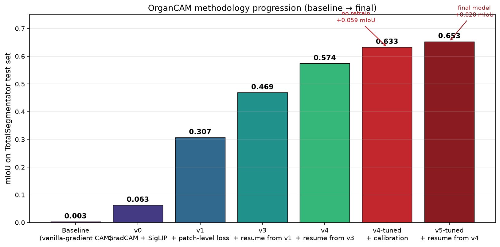
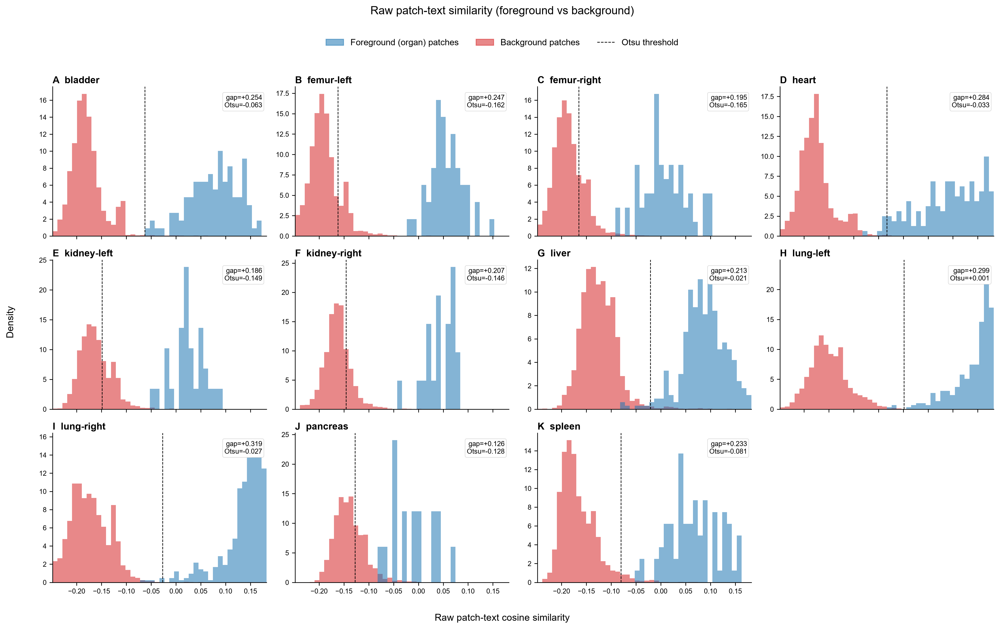
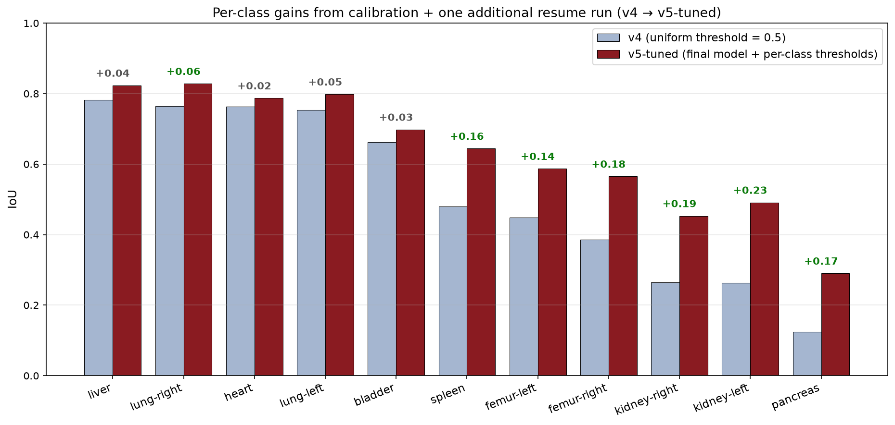
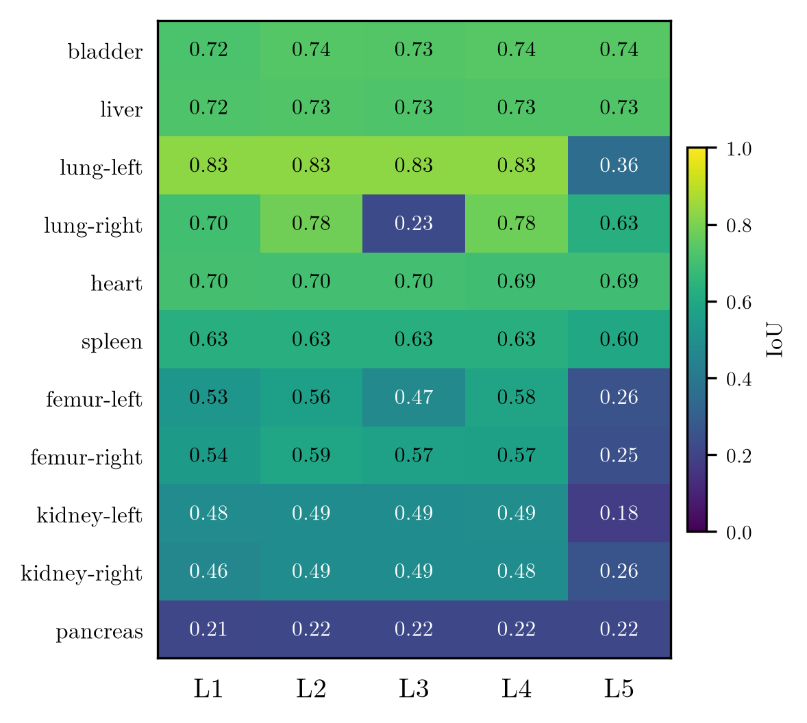
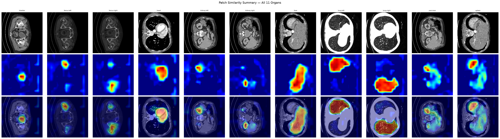

# OrganCAM

Text-supervised weakly-supervised organ localization in CT slices. Fine-tunes [BioMedCLIP](https://huggingface.co/microsoft/BiomedCLIP-PubMedBERT_256-vit_base_patch16_224) with a patch-level contrastive loss so that per-patch text–image cosine similarity acts as a segmentation map — no per-pixel labels required at inference.

## Results

Evaluated on the [TotalSegmentator v2.0.1](https://github.com/wasserth/TotalSegmentator) test split, 11 organ classes.

| Metric | Best (v5, epoch 11, per-class tuned thresholds) |
|---|---|
| mIoU | **0.653** |
| Dice | **0.757** |
| HD95 (px) | 18.8 |
| Sensitivity | 0.805 |
| Precision | 0.749 |
| RVE | 0.93 |
| NSD (τ=3px) | 0.557 |

**Progression across method iterations:**

| Version | Method | mIoU |
|---|---|---|
| Baseline | Vanilla-gradient CAM (no fine-tuning) | 0.003 |
| v0 | GradCAM + SigLIP fine-tuning | 0.063 |
| v1 | + patch-level contrastive loss | 0.307 |
| v3 | + resume from v1 | 0.469 |
| v4 | + resume from v3 | 0.574 |
| v4-tuned | + calibration fix (raw sims + per-class IoU-optimal thresholds) | 0.633 |
| **v5-tuned** | + one more 20-epoch resume from v4 | **0.653** |



The calibration step required no retraining: diagnostic analysis of raw patch-text similarity distributions (`scripts/analyze_similarities.py`) revealed that (a) per-image min-max normalization was destroying model-confidence information and (b) class-conditional negative subtraction was cutting foreground signal more than background. Removing both and calibrating per-class thresholds by sweeping IoU-optimal cutoffs on generated masks (`evaluate_masks.py --tune`) raised mIoU by +10% and cut HD95 in half.



The final v5 resume-run added +0.020 mIoU and, more meaningfully, lifted the hardest classes disproportionately: pancreas +21%, kidney-right +15%, femur-right +10%. Easy classes (liver, lungs, heart, bladder) had already saturated at v4-tuned and plateaued.



### Per-class mIoU (v5-tuned, final)

| Organ | N | IoU | Dice |
|---|---:|---:|---:|
| Lung Right | 535 | 0.828 | 0.897 |
| Liver | 492 | 0.823 | 0.893 |
| Lung Left | 545 | 0.798 | 0.875 |
| Heart | 480 | 0.787 | 0.866 |
| Bladder | 265 | 0.698 | 0.796 |
| Spleen | 464 | 0.644 | 0.768 |
| Femur Left | 260 | 0.587 | 0.722 |
| Femur Right | 262 | 0.565 | 0.706 |
| Kidney Left | 401 | 0.491 | 0.627 |
| Kidney Right | 403 | 0.453 | 0.595 |
| Pancreas | 395 | 0.290 | 0.419 |

Large, morphologically-distinct organs (liver, lungs, heart) reach 0.79-0.83 IoU with text supervision alone. Small, low-contrast organs (pancreas at 0.29) remain harder — competitive with published weakly-supervised methods on pancreas (typical range 0.20-0.35), but the inherent limit of the approach for structures without distinctive appearance.

## Comparison to fully-supervised segmentation

To contextualize these weakly-supervised results, we compare against [TotalSegmentator](https://pubs.rsna.org/doi/10.1148/ryai.230024) (Wasserthal et al., *Radiology: AI* 2023) — a fully-supervised 3D nnU-Net trained on the same dataset with dense per-voxel labels. Its published per-structure Dice (from the repo's `resources/results_all_classes_v1.json`) is the supervised reference ceiling; overall mean Dice across all 104 structures is **0.943**.

**Metric caveat — do not subtract these columns.** The two numbers are *not* the same metric:

- **OrganCAM** reports **2D per-slice Dice** on organ-present axial slices (top-K per volume).
- **TotalSegmentator** reports **3D volumetric Dice** over whole volumes.

2D slice Dice on organ-present slices is systematically *more forgiving* than 3D volumetric Dice (no empty or partial-boundary slices dragging the average down), so the true supervised → weakly-supervised gap is **wider** than the raw column difference suggests. Treat the TotalSegmentator column as an approximate upper bound achievable *with* full pixel supervision, not a like-for-like benchmark.

| Organ | OrganCAM Dice (2D, weakly-sup.) | TotalSegmentator Dice (3D, fully-sup.) |
|---|---:|---:|
| Liver | 0.893 | 0.965 |
| Spleen | 0.768 | 0.983 |
| Kidney Left | 0.627 | 0.953 |
| Kidney Right | 0.595 | 0.939 |
| Pancreas | 0.419 | 0.887 |
| Bladder | 0.796 | 0.934 |
| Femur Left | 0.722 | 0.914 |
| Femur Right | 0.706 | 0.942 |
| Heart | 0.866 | 0.937–0.955 † |
| Lung Left | 0.875 | 0.971 / 0.985 ‡ |
| Lung Right | 0.897 | 0.944–0.988 ‡ |

† TotalSegmentator v1 segments the heart as separate chambers, not a single structure. Range spans myocardium (0.937) to left ventricle (0.955). Our dataset (v2.0.1) uses a single merged heart label, so this row is not a direct 1:1 match.
‡ TotalSegmentator segments lungs per-lobe. Left = upper/lower lobe (0.971 / 0.985); right = upper/middle/lower lobe (0.944 / 0.975 / 0.988). Our labels merge lobes into whole left/right lung, so the whole-lung supervised Dice (not separately reported) would differ slightly.

**Takeaway.** On large, high-contrast organs (liver, lungs, heart) OrganCAM reaches 0.87–0.90 slice Dice with *no pixel labels* — within striking distance of supervised performance once the metric caveat is accounted for. The gap widens exactly where weak supervision is expected to struggle: small, low-contrast structures (pancreas 0.42 vs 0.89; kidneys 0.60–0.63 vs 0.94–0.95). This is the intended demonstration — text supervision recovers most of the localization signal for morphologically distinctive organs, and the residual gap quantifies the cost of removing dense annotation.

## Caption ablation

To characterize how much the model actually uses the prompt text (rather than memorizing organ appearance from images alone), the fine-tuned v4 model was re-evaluated with five prompt formulation levels — text embeddings the only variable, no retraining:

| Level | Description | Example (liver) |
|---|---|---|
| **L1** | Class name only | `"liver"` |
| **L2** | Generic clinical caption | `"Axial CT scan of the liver."` |
| **L3** | Position-only (organ name removed, position kept) | `"The liver occupies the left portion of the image extending toward the center in the top half."` |
| **L4** | Full anatomical description (used during training) | Multi-sentence description with morphology, position, adjacent structures<br>`"Axial CT scan of the upper abdomen showing the liver. Dominates the LEFT portion of the image from the left edge toward and past the center, in the top half. The right lobe is largest and sits furthest left in the image. The left lobe tapers toward image center. Intrahepatic vessels (portal and hepatic veins) branch throughout as tubular structures. The gallbladder may appear as a small oval hypodense structure at the bottom of the liver mass."` |
| **L5** | Adversarial (L4 with left/right and top/bottom swapped) | L4 with `LEFT ↔ RIGHT` and `top ↔ bottom`<br>`"Axial CT scan of the lower abdomen showing the liver. Dominates the RIGHT portion of the image from the right edge toward and past the center, in the bottom half. The left lobe is largest and sits furthest right in the image. The right lobe tapers toward image center. Intrahepatic vessels (portal and hepatic veins) branch throughout as tubular structures. The gallbladder may appear as a small oval hypodense structure at the top of the liver mass."` |

### Overall results

| Level | mIoU | Dice |
|---|---:|---:|
| L1 class_name | 0.607 | 0.728 |
| L2 generic_clinical | 0.627 | 0.744 |
| L3 position_only | 0.561 | 0.684 |
| **L4 full_anatomical** | **0.627** | **0.744** |
| L5 adversarial | 0.458 | 0.583 |

### Per-class heatmap



### Findings

**1. Class names carry most of the signal (L1 ≈ 96% of L4).** Fine-tuning made the organ-name → visual-region mapping strong enough that a single word reaches 96% of the mIoU obtained from the full multi-sentence descriptions.

**2. Position language is a refinement, not a substitute (L3 < L1).** Removing organ identity while keeping position cues *lowers* IoU below the class-name-only baseline. The model needs to know *what* to look for before *where* becomes useful.

**3. Bilateral pairs are prompt-sensitive; unilateral organs are prompt-robust.** Under L5 (adversarial position swaps), classes that rely on left/right disambiguation collapse (kidney-left -63%, lung-left -57%, femurs -55%) while organs with unique positions are unaffected (liver, spleen, heart, bladder unchanged). This is direct evidence that the model *uses* text position cues for localization — it isn't image-only classification with text as a passenger.

**4. Pancreas is data-limited, not prompt-limited.** IoU stays at 0.21-0.22 across every level, including L1 (just the word "pancreas") and L4 (full description). Prompt engineering will not fix pancreas; the ceiling is inherent to weakly-supervised text-driven segmentation for small, low-contrast structures.

### Unintended natural experiment

The L3 prompt for `lung-right` was auto-generated via Claude Haiku and contained a labeling error — the first two words are `"The left lung..."` describing the right lung's position. This single-word inconsistency contradicts the class label the model was trained against, and IoU on `lung-right` at L3 collapsed to 0.23 while `lung-left` at L3 held at 0.83. In effect: **one word swapped in one of eleven prompts cost 55 IoU points on the affected class** — a real-world illustration of the prompt sensitivity L5 was designed to probe.

### Qualitative masks



## Architecture

- **Backbone**: BioMedCLIP (ViT-B/16 visual encoder + PubMedBERT text encoder), 195M params
- **Fine-tuning**: ViT blocks 8-11 + BERT layers 8-11 + `visual.head` + `text.proj` + `logit_scale` + `logit_bias`
- **Loss**: `SigLipLoss` (global CLS-level contrastive) + λ · patch-level BCE
- **Patch-level contrastive loss**: forward hook on ViT block 11 captures 196 patch tokens per image, projects through `visual.head` (768→512), computes per-patch cosine similarity against the organ text embedding, then BCE against the GT segmentation mask downsampled to the 14×14 patch grid
- **Inference**: multi-layer patch-similarity fusion over ViT blocks 8-11, with negative-prompt subtraction to suppress background tissue; upsamples 14×14 similarity map to 224×224

## Setup

```bash
python -m venv .venv
.venv\Scripts\activate        # Windows
pip install torch torchvision --index-url https://download.pytorch.org/whl/cu128
pip install open_clip_torch nibabel scipy matplotlib pytest
pip install pydicom openpyxl   # bone-metastasis index (Phase 1): DICOM + clinical xlsx
```

Download the [TotalSegmentator dataset v2.0.1](https://zenodo.org/records/10047292) and unzip to `Totalsegmentator_dataset_v201/` in the project root.

## Usage

### Precompute slices (one-time, GPU-bound training prep)

```bash
python scripts/precompute_slices.py --root Totalsegmentator_dataset_v201
```

### Fine-tune

```bash
python scripts/train.py --root Totalsegmentator_dataset_v201 --epochs 20 --lambda_patch 0.5
```

Resume from a prior checkpoint (used to build v3 → v4 → v5):
```bash
python scripts/train.py --root Totalsegmentator_dataset_v201 --epochs 20 --resume_from checkpoints/totalseg_patch_v4/epoch_015_val3.7378.pt --checkpoint_dir checkpoints/totalseg_patch_v5
```

### Rank checkpoints across all epochs

```bash
python scripts/eval_checkpoints.py --checkpoint_dir checkpoints/totalseg_patch_v5 --root Totalsegmentator_dataset_v201 --limit 500
```

Writes `checkpoint_metrics.json` with IoU / Dice / HD95 / Sensitivity / Precision / RVE / NSD per epoch.

### Generate pseudo-masks from best checkpoint

```bash
python scripts/generate_masks.py --checkpoint checkpoints/totalseg_patch_v5/epoch_011_val3.4584.pt --root Totalsegmentator_dataset_v201 --method patch_sim
```

Masks are saved as raw patch-text similarity heatmaps (no per-image normalization). Per-class thresholds are applied at evaluation time.

### Score generated masks against GT with IoU-optimal per-class thresholds

```bash
python scripts/evaluate_masks.py --tune
```

This sweeps candidate thresholds per class, picks the IoU-optimal cutoff, saves them to `diagnostics/tuned_thresholds.json`, and evaluates. Use `--thresholds_json diagnostics/tuned_thresholds.json` on subsequent runs to reuse.

### Diagnostic: raw patch similarity distributions

```bash
python scripts/analyze_similarities.py --checkpoint checkpoints/totalseg_patch_v5/epoch_011_val3.4584.pt --root Totalsegmentator_dataset_v201
```

Produces per-class foreground vs background histograms in `diagnostics/`. Used to verify that the model has spatial signal before spending epochs on retraining.

### Visualize

```bash
python scripts/visualize_masks.py
```

## Bone-metastasis organ index (Phase 1)

Applies the same OrganCAM patch-similarity model to a second question: given a bone
metastasis, which organ is it closest to invading? This phase uses **ground-truth**
tumor localization (no weakly-supervised tumor detection yet — that's Phase 2) so the
index itself can be validated before adding a second layer of learned uncertainty.

**Datasets:**
- [Spine-Mets-CT-SEG](https://www.cancerimagingarchive.net/collection/spine-mets-ct-seg/) — primary anchor. 55 patients, 3D DICOM CT with per-vertebra SEG masks; lesion type (lytic/blastic/mixed) per vertebral level comes from the collection's clinical spreadsheet (`Spine-Mets-CT-SEG_Clinical.xlsx`), not the SEG file itself. Tumor mask = union of vertebra masks for levels the spreadsheet marks as involved.
- CT-ORG — organ-only NIfTI ground truth (liver, kidneys, lungs, bladder), used purely to sanity-check that OrganCAM's organ maps transfer to a CT protocol it wasn't trained on, before trusting the index.

**Index:** for each (tumor, organ) pair, `overlap = |T∩O|/|T|` and `proximity = 1/(1+d_mm)`
where `d_mm` is the minimum physical surface distance (`scipy.ndimage.distance_transform_edt`
with mm spacing, not voxel counts). The two are blended (`alpha*overlap + beta*proximity`,
default 0.5/0.5) per organ, and a patient's index is the max blended score across organs —
the nearest/most-involved organ drives the score. OrganCAM runs per-axial-slice (as in the
main pipeline above); 2D organ maps are stacked into a 3D organ-probability volume aligned
to the CT grid so distance can be computed in 3D against the 3D tumor mask.

**Scripts:**
```bash
# one patient -> results/bone_index/<case>.json
python scripts/compute_index.py --case 10355 --device cuda

# every labelled patient -> results/bone_index/summary.json (mean/median/min/max)
python scripts/batch_index.py --device cuda

# qualitative overlay: tumor + top-scoring organ map on the peak tumor slice
python scripts/visualize_index.py --case 10355 --device cuda

# organ-transfer sanity check on CT-ORG before trusting the index
python scripts/eval_organ_transfer.py --vol <ctorg volume> --labels <ctorg labels> --device cuda
```

α/β weighting, per-patient aggregation (currently max-over-organs), and organ thresholds
are open parameters — to be tuned once real per-patient scores exist across the full cohort.

## Project structure

```
src/
  data/           TotalSegmentator NIfTI loader, ImageTextDataset wrapper
  labels/         CLASS_NAMES, FEW_SHOT_TEMPLATES, NEGATIVE_PROMPTS
  training/       Trainer, freeze schedule, PatchContrastiveLoss
  explainability/ BioMedCLIPPatchSimilarity (inference-time mask generator)
scripts/
  precompute_slices.py  cache CT slices to .npy for GPU-bound training
  train.py              fine-tuning entrypoint (patch loss + SigLIP)
  eval_checkpoints.py   rank all epochs by full metric suite
  generate_masks.py     batch pseudo-mask generation
  evaluate_masks.py     score masks against TotalSegmentator GT
  visualize_masks.py    per-organ overlay figures
figures/
  totalseg/       per-class + summary pseudo-mask overlays
checkpoints/      per-epoch .pt files (gitignored, ~200MB each)
```

## Dataset

TotalSegmentator v2.0.1: 1,228 abdominal/thoracic CT volumes with per-organ segmentation labels. Volume-level 80/10/10 split. Slices sampled at top-K per organ per volume (default K=5). HU windowing applied for soft-tissue contrast, resampled to 224×224.

Checkpoints, generated masks, and the raw dataset (~50GB total) are excluded from this repo — run the scripts above to reproduce.

## Known limitations

- Patch supervision is fixed at 14×14, so boundary precision is inherently coarse — HD95 of 19 pixels on a 224px image reflects the upsampled patch grid.
- Pancreas remains the hardest class (0.29 IoU). Competitive with published weakly-supervised methods (typical 0.20-0.35), but small elongated low-contrast structures are near the natural ceiling for this approach.
- Kidneys reach 0.45-0.49 IoU. Prompt engineering to emphasize morphology (bean-shape, hilum orientation) rather than just position could help — the caption ablation showed adversarial position swaps destroy bilateral organs, indicating position is the dominant text cue used.
- Val loss (SigLIP CLS-level) does not track mIoU — rank checkpoints with `eval_checkpoints.py`, not by filename val loss.
